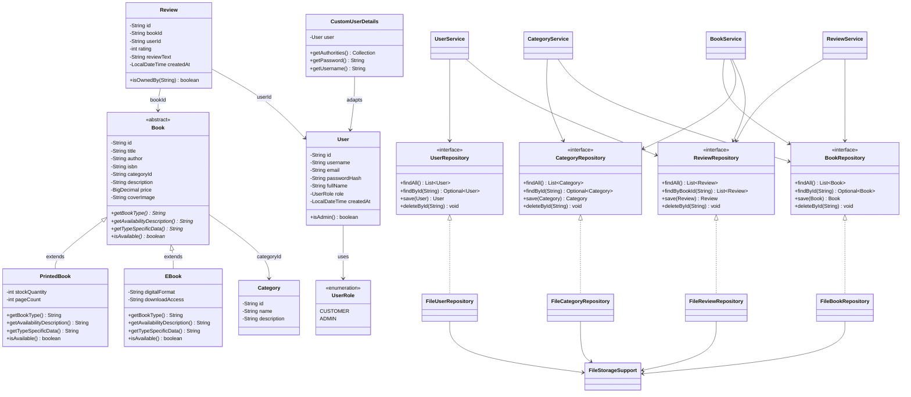

# Class Diagram — Family Books

This diagram matches the implemented source code (models, repositories, services, security adapter).

## Mermaid UML

## Important relationships (viva)

1. **Inheritance:** `PrintedBook` and `EBook` extend abstract `Book`.
2. **Polymorphism:** Controllers/services hold `Book` references; `getBookType()` / `getAvailabilityDescription()` resolve at runtime.
3. **Abstraction:** `Book` abstract class + repository interfaces hide storage details.
4. **Encapsulation / information hiding:** private fields; file parsing lives inside `repository.file` package.
5. **Association:** Reviews reference `bookId` and `userId`; books reference `categoryId`.

## Controllers (not fully expanded above)

- `HomeController`, `AuthController`, `BookController`, `UserController`, `ReviewController`, `AdminController`
- Each depends on service classes only (never on text files directly).
